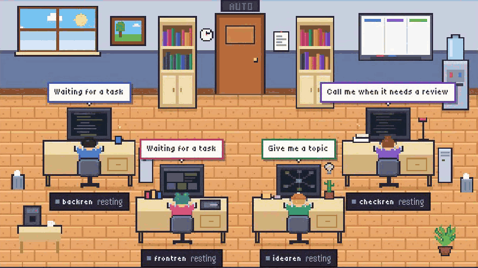
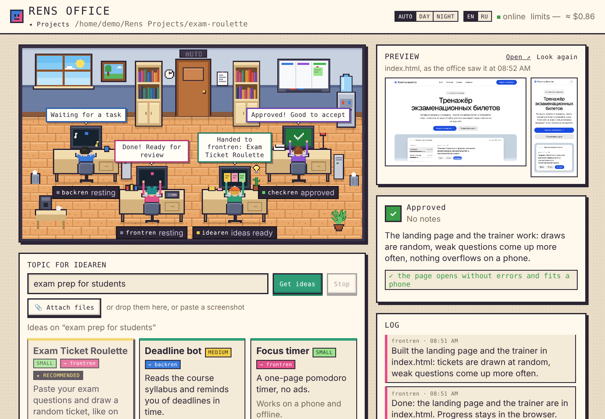
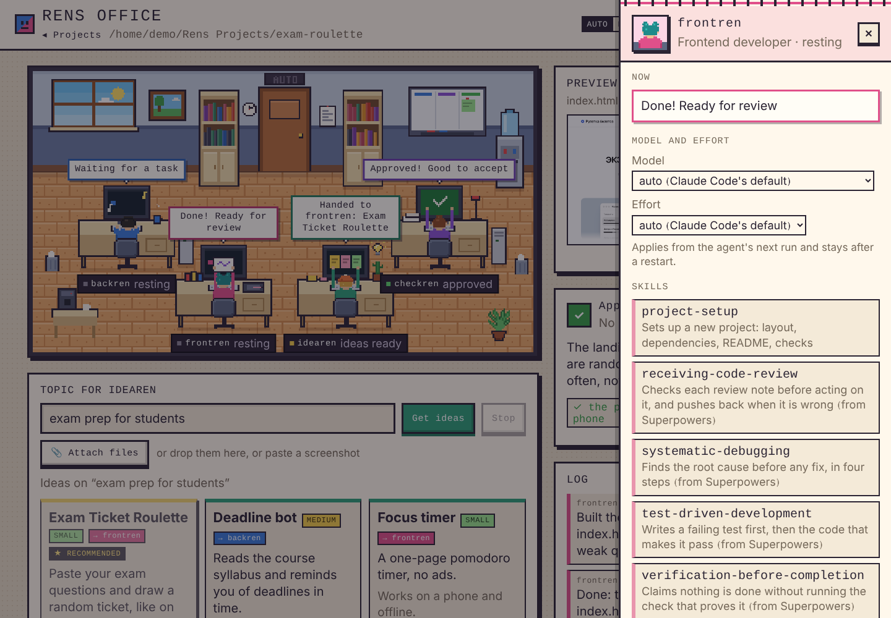
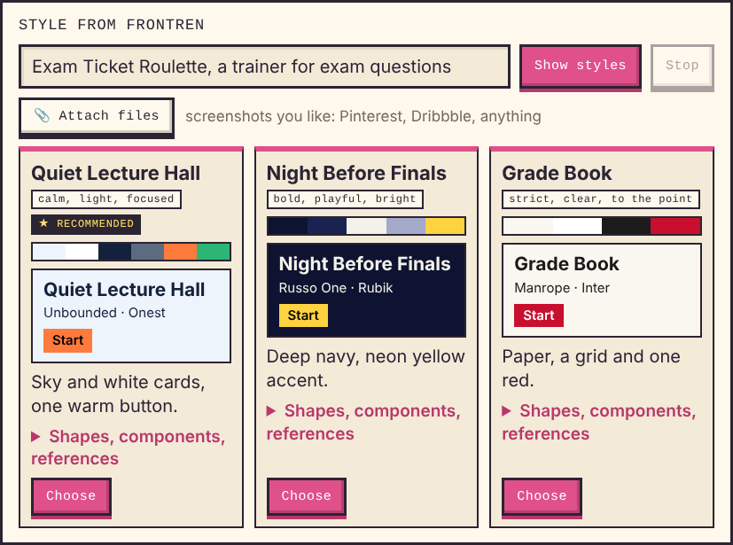
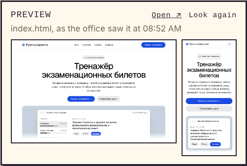
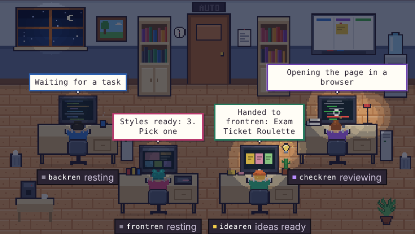

<div align="center">

# Rens Office

**A tiny pixel-art office where Claude Code agents come up with ideas, build them and review each other's work.**

[](https://github.com/baddeka/spaceeeeee/actions/workflows/tests.yml)

[](LICENSE)


[Русская версия](README.ru.md)



</div>

You give the office a topic. **idearen** suggests a few things worth building, **frontren** or
**backren** builds the one you pick, and **checkren** reviews it and sends it back until it's right.
You watch all of it happen at their desks, and nothing gets committed until you accept it.

It runs on your own computer, through [Claude Code](https://code.claude.com) and the subscription you
already have (Pro or Max). No API key, no server, no account anywhere else.

## Getting started

You need [Python 3.11+](https://www.python.org/downloads/), [git](https://git-scm.com/downloads) and
Claude Code, signed in once:

```bash
claude
```

Then get the office:

```bash
git clone https://github.com/baddeka/spaceeeeee rens-office
```

and start it the way that suits your system. Every start pulls the newest version first, sets itself
up the first time (about a minute), and opens the office in your browser.

| | |
|---|---|
| **Windows** | Double-click `Rens Office.bat`. Run `Add desktop shortcut.bat` once to get a desktop icon. |
| **macOS** | Double-click `Rens Office.command`. |
| **Linux** | `./rens-office.sh` |
| **Anywhere** | `pip install -e .` and then `rens-office --open` |

Nice to have, not required:

- **Chrome, Edge or Chromium.** The office opens what the agents build in it, takes screenshots for you
  and for the reviewer, and catches a broken page before the review.
- **Node.js 22+.** frontren then designs with [Taste Skill](https://github.com/Leonxlnx/taste-skill),
  which won our own design bake-off. It's downloaded once (about 40 MB) on the first start.

## How it works



1. **Get ideas.** Write a topic for idearen. It looks at your project, checks what already exists and
   comes back with 3 to 5 ideas, each with a pitch, a scope, a full brief and who should build it.
2. **Hand one over.** A sticky note flies to frontren's or backren's desk. Or skip the ideas and write
   a task yourself.
3. **Watch it get built.** The developer works in the project's folder: it writes files, runs
   commands and tests, and its speech bubble tells you what it's doing. When it touches a page, the
   office opens it in a browser and shows you desktop and phone screenshots.
4. **Call checkren.** It reads the whole change, runs your checks, looks at the screenshots and gives
   a verdict. Notes go back to whoever built it, who still remembers the task.
5. **Accept.** The work is committed to git, and the next task starts from there.

Turn on **Autopilot** and steps 2 to 4 run by themselves, up to a number of rounds you choose.
Accepting always stays with you.

## The team

| | Does | Leans on |
|---|---|---|
| **idearen** | Proposes what to build and writes the brief | brainstorming, a quick market check, briefs a developer can build from without questions |
| **backren** | Data, APIs, logic | API design (it keeps `API.md` for frontren), data models, [Ponytail](https://github.com/DietrichGebert/ponytail) to keep changes small |
| **frontren** | Pages, components, the look | [Taste Skill](https://github.com/Leonxlnx/taste-skill) or its own design skills, ready-made UI kits and icons, real interface copy, following a screenshot or a Figma file |
| **checkren** | Reviews and never edits | edge cases, test quality, frontend and design review, [Cloudflare's security audit](https://github.com/cloudflare/security-audit-skill) |

Both developers also use four skills from [Superpowers](https://github.com/obra/superpowers):
test-driven development, systematic debugging, verification before completion and receiving code
review. Click any agent to open its drawer with its skills, what it's doing, and its model.



Skills are plain `SKILL.md` files in `office/skills/`, loaded only into that agent's runs. Drop a new
folder in and the agent picks it up.

## More things it does

**Styles before building.** Tell frontren what the product is (and attach screenshots you like, if
you have them), and it proposes three distinct directions with a palette, fonts and a little preview.
The one you choose goes into the project's `DESIGN.md`, and frontren sticks to it.



**A live preview.** After frontren works on a page, the office shows it at desktop and phone size
and lists what's wrong: script errors, files that didn't load, things sticking out on a phone, text
too faint to read. **Open** shows the real page in your browser.



**Projects.** Each project is a folder in `Documents/Rens Projects`. The office remembers where every
project stands (the task, the verdict, the ideas, the log) and picks up where you left off. You can
also open any existing repository; work on a branch of your own, since the office commits there.

**Files.** Attach a design, a PDF brief or a dataset to a task or a topic, or paste a screenshot.

**Figma.** If your Claude Code has Figma connected, put a figma.com link in a task and frontren builds
from that design. It only gets Figma's read-only tools.

**Model per agent.** idearen can think on Haiku while frontren builds on Opus. Your choices and the
language (English or Russian) are remembered.

**Day and night.** The office follows your clock. Idle agents read, sketch, juggle or nap; at night
they sleep, and whoever still has work keeps going by the desk lamp.



## Saving your limits

Every task and review comes out of your subscription limits, so the office tries not to waste them.
The header shows how much of your 5-hour and weekly limits is used.

- If your checks fail, or the page doesn't open, the work goes straight back to the developer without
  spending a review on it.
- A re-review gets the earlier notes and checks each one, instead of starting over.
- Agents run without the MCP servers you've set up elsewhere, so their tool lists don't eat the
  context.
- When a project is reopened, the agents get a short summary instead of resuming a long conversation.

## Safety

The developers run commands on your computer, the same way Claude Code does when you use it
yourself. `--no-bash` turns that off. idearen and frontren read web pages, so treat their briefs as
text from the internet; with Autopilot on, a brief reaches a developer before you've read it.

The office listens only on `127.0.0.1` and refuses requests from other sites. It never pushes, and it
commits every file git doesn't ignore, so keep secrets like `.env` in `.gitignore`.

## Options

| Flag | |
|---|---|
| `--open` | open the office in the browser once it's up |
| `--projects DIR` | where projects live (default `Documents/Rens Projects`) |
| `--workspace DIR` | open this folder right away instead of the project list |
| `--port N` | default 8000; the preview uses the next one |
| `--lang en\|ru` | language of the page and the agents (default: the last one you picked) |
| `--model M`, `--effort E` | defaults for agents left on *auto* |
| `--no-bash` | developers can't run shell commands |
| `--no-skills` | agents run without the office's skills |
| `--no-preview` | don't open pages in a browser |
| `--host`, `--allow-host` | listen elsewhere, or accept another host name (e.g. Tailscale) |

Checks to run before every review go in the project's `.ai-review.toml`:

```toml
checks = ["python -m pytest -q"]
```

## ai-review

The office's reviewer also works on its own, for any repository or CI:

```bash
ai-review --base main --check "pytest -q"
```

It prints a verdict and exits non-zero on CHANGES REQUESTED. The verdict comes from the code, not the
model: a failing check or any `critical` or `major` note blocks approval. `ai-review --help` lists the
rest, including `--backend api` for running it with an `ANTHROPIC_API_KEY` instead of a subscription.

## Contributing

Issues and pull requests are welcome. [CONTRIBUTING.md](CONTRIBUTING.md) explains how to run the tests
(they use a stand-in for Claude, so they're free and work offline).

## Licence

MIT, see [LICENSE](LICENSE). The skills borrowed from other projects keep their own licences, listed
in [THIRD_PARTY_NOTICES.md](THIRD_PARTY_NOTICES.md).
