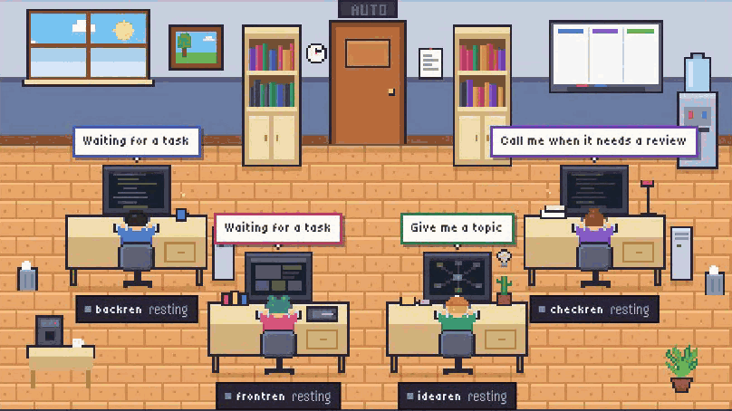
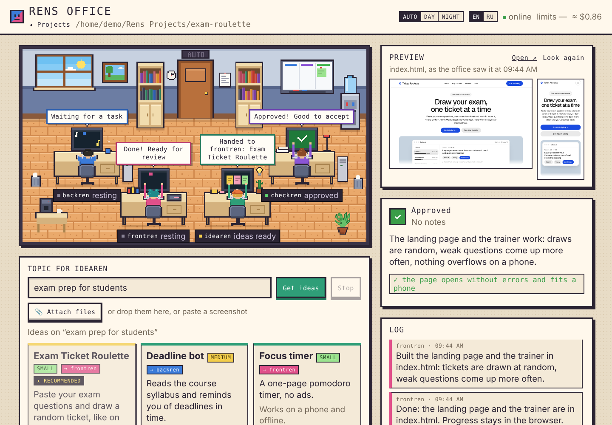
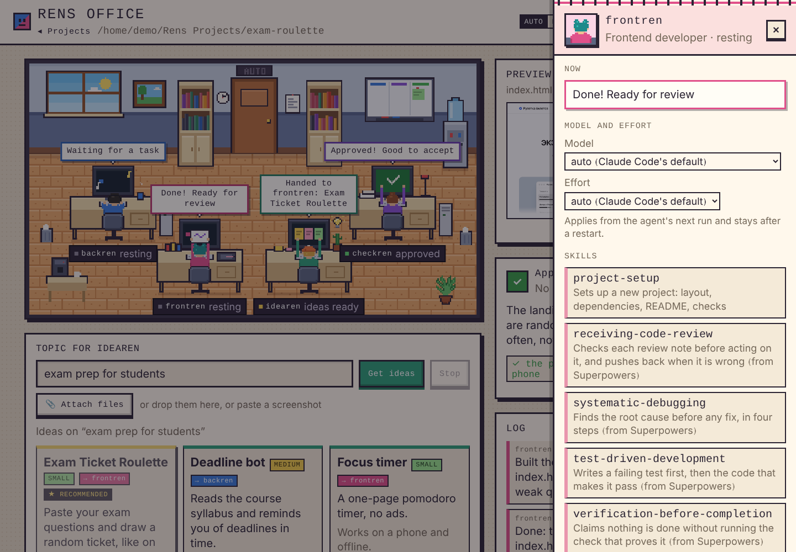
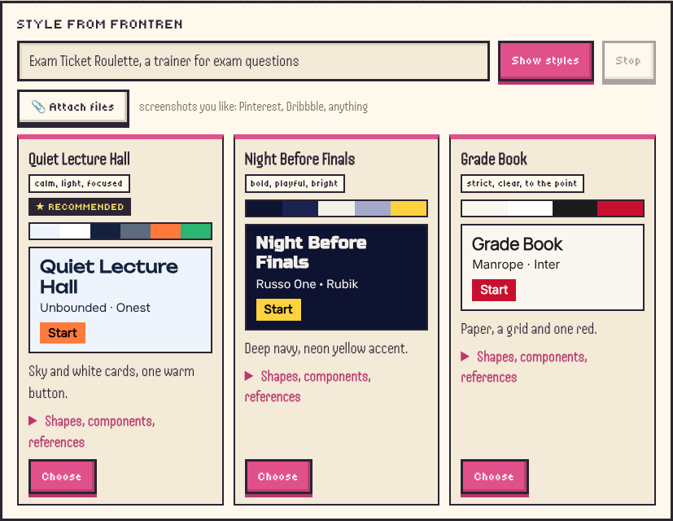
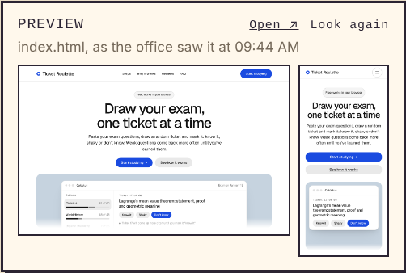
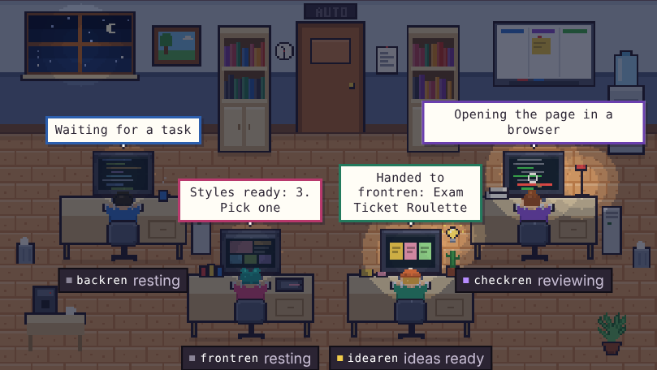

<div align="center">

# Rens Office

**Маленький пиксельный офис, где агенты Claude Code придумывают идеи, делают их и проверяют работу друг друга.**

[](https://github.com/baddeka/rens-office/actions/workflows/tests.yml)

[](LICENSE)


[English version](README.md)



</div>

Даёшь офису тему. **idearen** предлагает, что можно сделать, **frontren** или **backren** делает
выбранное, а **checkren** проверяет и возвращает на доработку, пока не будет хорошо. Всё это видно
прямо за их столами, и ничего не коммитится, пока ты сам не примешь работу.

Офис работает у тебя на компьютере, через [Claude Code](https://code.claude.com) и подписку, которая
у тебя уже есть (Pro или Max). Без API-ключа, без сервера, без регистраций где-то ещё.

## Как запустить

Одна строка ставит всё нужное и открывает офис.

**macOS или Linux**, в Терминале:

```bash
curl -fsSL https://raw.githubusercontent.com/baddeka/rens-office/HEAD/install.sh | sh
```

**Windows**, в PowerShell:

```powershell
irm https://raw.githubusercontent.com/baddeka/rens-office/HEAD/install.ps1 | iex
```

Скрипт поставит то, чего не хватает (Git на Windows, [uv](https://docs.astral.sh/uv/), который сам
приносит Python, и Claude Code), положит офис в папку `rens-office` в твоей домашней папке и добавит
ярлык **Rens Office**: на рабочий стол и в меню «Пуск» на Windows, на рабочий стол на Mac, в меню
приложений на Linux. Потом попросит один раз войти в Claude и откроет офис. Скрипты короткие, их можно
сначала прочитать: [install.sh](install.sh), [install.ps1](install.ps1).

Дальше запускай с ярлыка. Каждый запуск сначала обновляет офис.

**Твой аккаунт Claude.** Каждый входит в свой аккаунт Claude (Pro или Max, API-ключ не нужен), и работа
агентов тратит лимиты именно этого аккаунта. Вход делает сам Claude Code и хранит его у тебя на
компьютере. Офис его не видит и не сохраняет: он только спрашивает у Claude Code, вошёл ли кто-нибудь, и
если нет, пишет об этом вверху страницы.

**Уже склонировал репозиторий?** Двойной клик по `Rens Office.bat` на Windows или `Rens Office.command`
на Mac, или `./rens-office.sh` на Linux. Через pip: `pip install -e .`, потом `rens-office --open`.

Желательно, но не обязательно:

- **Chrome, Edge или Chromium.** Офис открывает в нём то, что сделали агенты, снимает скриншоты для
  тебя и для проверяющего и ловит сломанную страницу ещё до ревью.
- **Node.js 22+.** Тогда frontren рисует с [Taste Skill](https://github.com/Leonxlnx/taste-skill),
  который победил в нашем сравнении дизайнов. Он скачивается один раз (около 40 МБ) при первом запуске.

Язык переключается кнопками EN / RU в шапке, офис его запоминает.

## Как это работает



1. **Идеи.** Напиши тему для idearen. Он посмотрит на проект, проверит, что уже существует, и
   предложит 3–5 идей: суть, объём, полное ТЗ и кому её делать.
2. **Передай идею.** Стикер улетает на стол frontren или backren. Можно и без идей: просто напиши
   задачу сам.
3. **Смотри, как делают.** Разработчик работает в папке проекта: пишет файлы, запускает команды и
   тесты, а в облачке над ним видно, чем он занят. Если он трогал страницу, офис открывает её в
   браузере и показывает скриншоты с компьютера и с телефона.
4. **Позови checkren.** Он читает всё изменение, запускает проверки, смотрит скриншоты и выносит
   вердикт. Замечания уходят тому, кто делал, и тот помнит задачу.
5. **Прими.** Работа коммитится в git, и следующая задача начинается отсюда.

Включи **Автопилот**, и шаги 2–4 пойдут сами, до заданного числа кругов. Принимать работу всегда
будешь ты.

## Команда

| | Что делает | На что опирается |
|---|---|---|
| **idearen** | Предлагает, что сделать, и пишет ТЗ | мозговой штурм, быстрая проверка рынка, ТЗ, по которому делают без вопросов |
| **backren** | Данные, API, логика | проектирование API (ведёт `API.md` для frontren), модели данных, [Ponytail](https://github.com/DietrichGebert/ponytail), чтобы не писать лишнего |
| **frontren** | Страницы, компоненты, внешний вид | [Taste Skill](https://github.com/Leonxlnx/taste-skill) или свои навыки дизайна, готовые UI-киты и иконки, живые тексты интерфейса, работа по скриншоту или макету в Figma |
| **checkren** | Проверяет и ничего не правит | граничные случаи, качество тестов, ревью фронтенда и дизайна, [аудит безопасности от Cloudflare](https://github.com/cloudflare/security-audit-skill) |

У обоих разработчиков есть ещё четыре навыка из [Superpowers](https://github.com/obra/superpowers):
разработка через тесты, системная отладка, проверка перед «готово» и разбор замечаний ревью. Нажми
на агента, и откроется его шторка: навыки, чем он занят и на какой модели работает.



Навыки лежат обычными файлами `SKILL.md` в `office/skills/` и подключаются только к своему агенту.
Добавишь папку с новым навыком, и агент начнёт им пользоваться.

## Что ещё умеет

**Стиль до вёрстки.** Расскажи frontren, что за продукт (и приложи скриншоты, которые нравятся, если
есть), и он предложит три разных направления: палитру, шрифты и маленький пример. Выбранное
записывается в `DESIGN.md` проекта, и frontren его держится.



**Превью.** Когда frontren поработал над страницей, офис показывает её на компьютере и на телефоне и
перечисляет, что не так: ошибки скриптов, незагрузившиеся файлы, то, что вылезает за экран телефона,
слишком бледный текст. **Открыть** показывает настоящую страницу в браузере.



**Проекты.** Каждый проект — папка в `Documents/Rens Projects`. Офис помнит, где остановился каждый
проект (задача, вердикт, идеи, журнал), и продолжает с того же места. Можно открыть и свой
репозиторий, только переключись на свою ветку: офис коммитит в текущую.

**Файлы.** Приложи к задаче или теме макет, ТЗ в PDF или данные, или вставь скриншот.

**Figma.** Если в твоём Claude Code подключена Figma, дай в задаче ссылку на figma.com, и frontren
сделает по этому макету. Ему достаются только инструменты Figma для чтения.

**Своя модель у каждого.** idearen может думать на Haiku, пока frontren делает на Opus. Выбор и язык
запоминаются.

**День и ночь.** Офис живёт по твоим часам. Свободные агенты читают, рисуют, жонглируют или дремлют,
ночью спят, а у кого есть работа, работает при настольной лампе.



## Как офис бережёт лимиты

Каждая задача и проверка тратит лимиты подписки, поэтому офис старается не тратить их зря. В шапке
видно, сколько израсходовано из 5-часового и недельного лимита.

- Если проверки упали или страница не открывается, работа сразу возвращается разработчику, без
  ревью моделью.
- Повторное ревью получает прошлые замечания и проверяет каждое, а не начинает заново.
- Агенты запускаются без MCP-серверов, которые у тебя настроены для другого, и их описания не
  забивают контекст.
- Когда проект открывают снова, агенты получают короткую сводку, а не продолжают длинный разговор.

## Безопасность

Разработчики запускают команды на твоём компьютере, как и Claude Code, когда ты работаешь с ним сам.
`--no-bash` это выключает. idearen и frontren читают сайты, так что их ТЗ — это текст из интернета;
с автопилотом ТЗ доходит до разработчика раньше, чем ты его прочитаешь.

Офис слушает только `127.0.0.1` и отклоняет запросы с чужих сайтов. Он никогда не пушит и коммитит
всё, что git не игнорирует, поэтому секреты вроде `.env` держи в `.gitignore`.

## Параметры

| Флаг | |
|---|---|
| `--open` | открыть офис в браузере после запуска |
| `--projects DIR` | где лежат проекты (по умолчанию `Documents/Rens Projects`) |
| `--workspace DIR` | сразу открыть эту папку, без списка проектов |
| `--port N` | по умолчанию 8000; превью берёт следующий |
| `--lang en\|ru` | язык страницы и агентов (по умолчанию последний выбранный) |
| `--model M`, `--effort E` | значения для агентов, у которых стоит *auto* |
| `--no-bash` | разработчики не могут запускать команды |
| `--no-skills` | агенты работают без навыков офиса |
| `--no-preview` | не открывать страницы в браузере |
| `--host`, `--allow-host` | слушать другой адрес или принимать другое имя хоста (например, Tailscale) |

Проверки перед каждым ревью задаются в `.ai-review.toml` проекта:

```toml
checks = ["python -m pytest -q"]
```

## ai-review

Проверяющий из офиса работает и сам по себе, для любого репозитория или CI:

```bash
ai-review --base main --check "pytest -q"
```

Он печатает вердикт и при CHANGES REQUESTED завершается с ненулевым кодом. Вердикт выносит код, а не
модель: упавшая проверка или любое замечание `critical` или `major` не дают одобрить. Остальное — в
`ai-review --help`, в том числе `--backend api`, чтобы работать с `ANTHROPIC_API_KEY` вместо подписки.

## Как помочь

Issues и pull request'ы приветствуются. В [CONTRIBUTING.md](CONTRIBUTING.md) написано, как запустить
тесты (вместо Claude там заглушка, так что они бесплатные и работают без интернета).

## Лицензия

MIT, см. [LICENSE](LICENSE). Навыки, взятые из других проектов, остаются под своими лицензиями, они
перечислены в [THIRD_PARTY_NOTICES.md](THIRD_PARTY_NOTICES.md).
